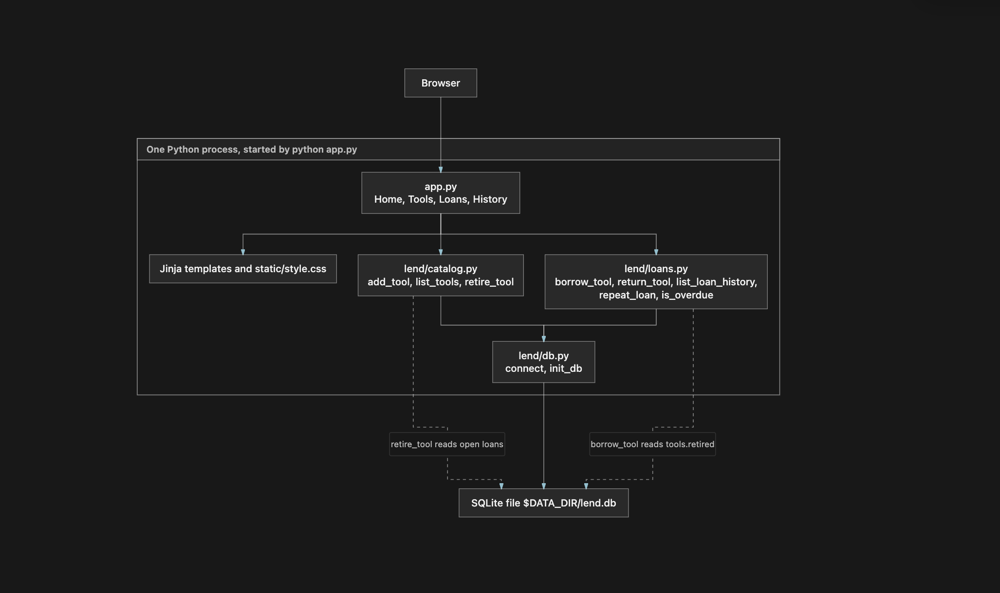
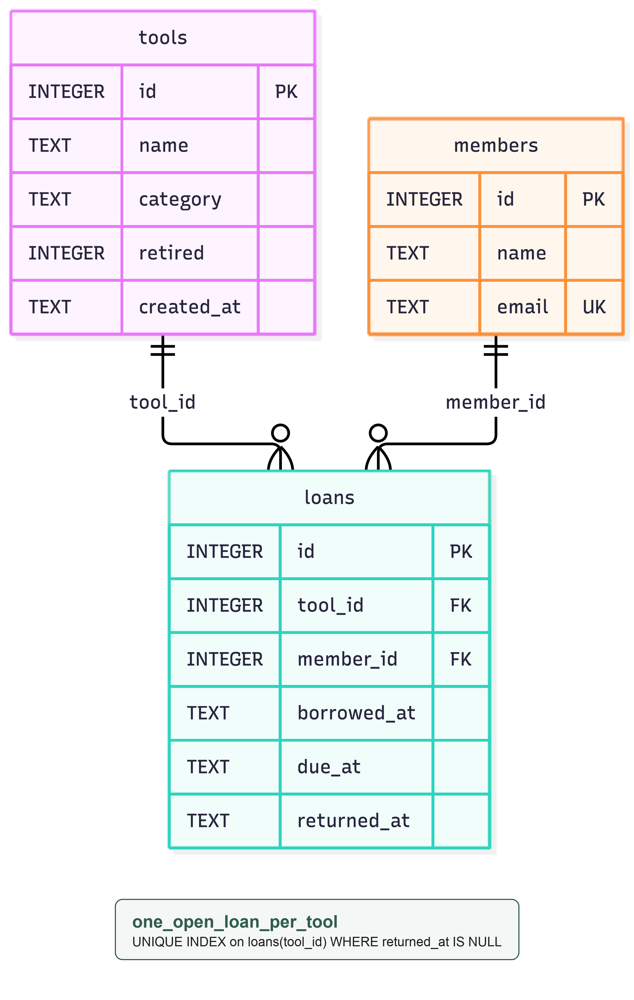

# Lend

Lend is a one-desk tool library for a volunteer workshop. One location, a few dozen tools, and a few hundred loans a year. One Python process and one SQLite file match that load. This report covers how the app was built. The architecture and the database diagram below match the running process.

## SDLC

I used iterative and incremental delivery. The assignment fixed the constraints before any code: one process, SQLite at one path, two feature domains, and a startup command configured only by environment variables. The design of those domains was not fixed up front. Each day shipped one slice that a volunteer could use, or one check that the slice still worked, and the ADR log recorded the decision that slice forced.

A waterfall plan would have written all five ADR entries on the first day and then built to that document. That would have hidden the real order. Catalog existed before anyone could borrow a tool. The rule that a tool out on loan cannot be retired only became concrete once `loans` had a `returned_at` column. Overdue was computed when the loan list was read, which is also why ADR-5 refuses a reminder worker. Those decisions belong on the days they were made.

The goals below are the ones the repository actually met.

**Startup.** By 30 September the app starts with `python app.py`, binds to `0.0.0.0`, and creates the SQLite file from `PORT` and `DATA_DIR`. `PORT` defaults to 5000. `DATA_DIR` defaults to `data`, and the file is `lend.db` inside that directory. `main` calls `init_db` before it serves requests, so a fresh clone does not need a migration prompt.

**Catalog.** By 30 September a volunteer can add a tool and retire it. `add_tool` stores `retired` as 0. `retire_tool` raises `ToolIsOut` when a loan for that tool still has `returned_at` null. That is the catalog domain: `lend/catalog.py` owns writes to `tools`.

**Loans.** By 5 October a volunteer can register a member, borrow an available tool for seven days, return it, and see Overdue. `borrow_tool` sets `due_at` through `due_at_for`, which adds `LOAN_DAYS` (7) to the borrowed time. `return_tool` sets `returned_at` and does not update `tools`. `is_overdue` is true only when `returned_at` is empty and the current time is past `due_at`. The partial unique index `one_open_loan_per_tool` keeps a second open loan from being inserted.

**Tests.** By 6 October the command `pytest --cov=lend.catalog --cov=lend.loans --cov-report=term-missing` reports 96% on those two modules. The tests call the domain functions on a temporary SQLite file. They do not go through the Flask routes. ADR-4 records that choice: the graded logic is the rules, and the routes only open a connection and render a template.

What this process did not include is a volunteer sitting at the desk and trying the pages. I checked the flows myself: add a tool, retire it, refuse a retire while it is out, borrow, return, and see Overdue on a past due date. That is a developer check, not a user test. The schema below was drawn after those slices, because the tables and the seam between `lend/catalog.py` and `lend/loans.py` were still moving while the features landed.

## One loan, end to end

A volunteer adds a hammer on `/tools`. `add_tool` stores the name, the category, and `retired` as 0. They register a member on `/loans`. `add_member` stores the stripped name and a lowercased email, and rejects a second member with the same email. They lend the hammer. `borrow_tool` starts `BEGIN IMMEDIATE`, checks that the tool exists and is not retired, checks that the member exists, and checks that no loan for that tool still has `returned_at` null. It then inserts one row. `due_at_for` sets `due_at` to `borrowed_at` plus `LOAN_DAYS`, which is 7. The home page counts that hammer as out. `desk["free"]` no longer includes it.

If the hammer is still out after `due_at`, `list_open_loans` calls `is_overdue` and the loans page shows Overdue on that row. Returning the hammer calls `return_tool`, which writes `returned_at` and leaves `tools.retired` at 0. The hammer is free again because `list_available_tools` hides a tool only when it is retired or has an open loan. The returned row shows on `/loans/history`. Repeat posts to `/loans/<id>/repeat`. `repeat_loan` calls `borrow_tool` with the same `tool_id` and `member_id`, so the old `returned_at` stays filled in and a new row is inserted for another seven days.

The same rule is enforced in the database. `test_open_loan_index_rejects_a_second_open_row` inserts one open loan and one already returned loan for the same tool, then a second insert with `returned_at` null raises `sqlite3.IntegrityError`. That failure comes from `one_open_loan_per_tool`. `borrow_tool` also refuses a second open loan in Python, before the insert. The index is the backstop when that check is skipped.

## Startup, and the seam Assignment 2 will use

`python app.py` is the only start command. `main` calls `init_db` before it serves, so a fresh clone creates `$DATA_DIR/lend.db` with no prompt and no migration step. The process binds to `0.0.0.0` and reads `PORT`, which defaults to 5000. `connect` creates the data directory, turns on foreign keys, and returns rows as `sqlite3.Row`. The only dependency manifest is `requirements.txt` at the repo root. The app does not need a Dockerfile, a compose file, or a second process to run.

Assignment 2 can split the two modules along the boundary that already exists. Catalog routes would keep `lend/catalog.py` and the `tools` table. Loan routes would keep `lend/loans.py`, `members`, and `loans`. The shared SQLite file is the part that would become two stores. Until then, `retire_tool` reads `loans` with SQL and does not import `lend/loans.py`. `borrow_tool` reads `tools.retired` through that same file.

## Architecture

`python app.py` starts one process. The browser talks only to routes in `app.py`. Those routes render Jinja templates and `static/style.css` from the same process. Tool routes call `lend/catalog.py`. Loan, return, history, and repeat routes call `lend/loans.py`. Both modules ask `lend/db.py` for a connection, and that connection opens `$DATA_DIR/lend.db`.

History is a loans page, not a third domain. `repeat_loan` calls `borrow_tool` inside `lend/loans.py` and inserts a new row. It does not clear `returned_at` on the old loan. `retire_tool` is the only catalog function that reads the `loans` table, and it does that with SQL to refuse a tool that is still out. It does not import `lend/loans.py`. `borrow_tool` reads `tools.retired` the same way, through the shared database file.

## Database

`lend/db.py` creates three tables in `$DATA_DIR/lend.db`. Catalog owns `tools`. Loans owns `members` and `loans`. There is no history table. A returned loan stays in `loans` with `returned_at` filled in, and repeating it inserts a new row.

`loans.tool_id` references `tools.id`, and `loans.member_id` references `members.id`. One tool and one member can each appear on many loan rows over time. The note under the loans table is `one_open_loan_per_tool`: a unique index on `loans(tool_id)` where `returned_at` is null. It is not a column. While `returned_at` is empty, the tool is out. `is_overdue` compares `due_at` with the current time, so overdue is not a column either.

